# MRE inversion with synthetic ground truth: a 2D pilot

**Authors:** Shakeel J and Soundharya Y

This repository contains a 2D simulation study of stiffness estimation (inversion) in brain magnetic resonance elastography (MRE). Because every brain is synthetic, the true stiffness is known at every voxel. We use that to measure inversion error directly, to test whether physics-based checks can flag unreliable voxels, and to check whether sparse regression can recover the governing wave equation from the simulated wave fields.

## Summary

- A learned inversion trained on realistic, heterogeneous patches (ILI) beats direct inversion (DI) on 75 held-out test brains at SNR 20. Median absolute stiffness error is 6.8 % versus 10.3 %, and correlation with the true stiffness is 0.84 versus 0.50.
- A trust map that combines anatomy, the network output and a noise-corrected physics consistency check detects badly wrong voxels with AUC 0.70, against 0.61 for a "distrust voxels near CSF" baseline. Keeping the 10 % most-trusted voxels lowers the median error from 7.6 % to 4.9 %.
- Weak-form SINDy, given a library of 12 candidate terms, selects exactly the two second-derivative terms of the wave equation in 79–93 % of uniform regions from clean data down to SNR 20. The stiffness read from the recovered equation is within 1–1.3 % of the true value.

## Motivation

MRE images the propagation of externally driven shear waves (here at 60 Hz) and converts the measured displacement field into a map of tissue stiffness. This conversion, the inversion, is an ill-posed inverse problem. It is sensitive to noise, to the finite voxel size and to how stiffness is assumed to vary in space.

Two practical problems motivate this pilot:

1. **No ground truth on real scans.** In vivo, the true stiffness is never known, so it is hard to tell whether an inversion is right or where it fails. Phantoms give ground truth only for simple geometries.
2. **The homogeneity assumption.** Direct inversion and many learned inversions assume stiffness is locally uniform. In the brain this assumption breaks down at tissue boundaries, in thin cortex and next to cerebrospinal fluid (CSF). Scott et al. (2022) showed that it biases cortical stiffness estimates.

Synthetic brains with known stiffness let us measure both effects directly, test whether errors can be detected without ground truth, and ask whether the wave physics itself can be recovered from the data.

## Pipeline

| Stage | What it does |
|---|---|
| A | Builds 500 synthetic 2D brains from SynthSeg segmentations of healthy ageing templates (ages 60–90), with random grey and white matter stiffness, smooth variation, 0–3 inclusions and damping. |
| B | Validates the finite-volume wave simulator (checkpoint C1), then simulates 60 Hz shear waves on a 0.5 mm grid and averages them to 3 mm voxels. |
| C | Cuts 7 × 7-voxel patches with added noise (SNR 5–50) and trains fully connected networks: ILI on realistic patches (5-member ensemble) and HLI on uniform patches (2-member ensemble). |
| D | Evaluates DI, HLI and ILI on the 75 test brains at fixed SNR 5, 10, 20 and 50 (experiments E2, E3). |
| E | Trust map v1: physics residual, ensemble spread and their combination, compared with simple baselines (E5). |
| F | Trust map v2 and v2.1: noise-corrected physics correction, error-predicting network and region-level scores. Developed on validation brains, scored once on test brains. |
| E6 | Weak-form SINDy per voxel at 60 Hz: uniform (M0) versus linearly varying (M1) stiffness models. |
| E7 | SINDy with a 12-term library on uniform regions, with Pareto model selection and Ensemble-SINDy inclusion probabilities. |

### Repository layout

| File | Purpose |
|---|---|
| `stage_a_make_brains.py` | Stage A: synthetic brains (stiffness and damping maps), catalogue and QC figure. |
| `mre_solver.py` | Shared 2D time-harmonic viscoelastic wave solver (sparse finite-volume system). |
| `b1_checks.py` | Checkpoint C1: wavelength accuracy, grid convergence, direct-inversion bias. |
| `stage_b2_simulate.py` | Stage B: simulates waves for every brain and saves the clean 3 mm data. |
| `mre_patches.py` | Shared functions for noise, patch extraction and uniform (HLI) patches. |
| `stage_c1_make_patches.py` | Stage C1: training and validation patches. |
| `stage_c2_train.py` | Stage C2: trains the ILI and HLI network ensembles. |
| `mre_di.py` | Baseline direct (algebraic Helmholtz) inversion. |
| `stage_d1_evaluate.py` | Stage D: test-set evaluation of DI, HLI and ILI (E2, E3); saves predictions. |
| `stage_e1_trust_map.py` | Stage E: trust map v1 (E5). |
| `stage_f1_predict_val.py` | Runs the ILI networks on the validation brains for trust-map development. |
| `stage_f2_trust_v2.py` | Trust map v2. |
| `stage_f3_trust_v21.py` | Trust map v2.1 (`dev` on validation brains, `final` on test brains). |
| `stage_e6_weak_windy_60hz.py` | Stage E6: per-voxel weak-form SINDy model selection at 60 Hz. |
| `stage_e7_sindy_library.py` | Stage E7: SINDy with a 12-term library on uniform regions. |
| `figures/` | Result figures shown in this README. |

Generated data (`mre_project/`, several GB) and the SynthSeg templates (`example/`) are not tracked.

## Results

### Synthetic brains and simulator validation

The 500 brains are split by slice level into 350 training, 75 validation and 75 test brains, so neighbouring slices never appear in different sets. CSF is modelled as a soft solid (G' = 1 kPa, damping ratio 0.5).

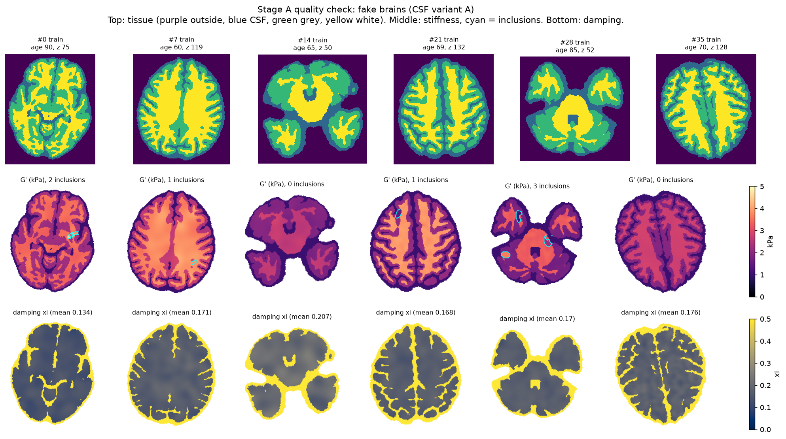
*Six training brains: tissue classes (top), storage modulus G' with inclusions outlined in cyan (middle), damping ratio (bottom).*

The simulator reproduces the analytical plane-wavelength to within 0.6 % on the 1 mm grid, with second-order convergence: the error falls by a factor of four each time the grid spacing is halved. On a full brain, the 0.5 mm grid differs from a 0.25 mm reference by 0.9 % (1 mm: 3.3 %), so all brains are simulated at 0.5 mm. Direct inversion is exact on the fine grid. On the 3 mm acquisition grid it overestimates stiffness by +10.2 % at 1 kPa and by +1.9 % at 5 kPa, because the coarse discrete Laplacian underestimates the wave curvature.

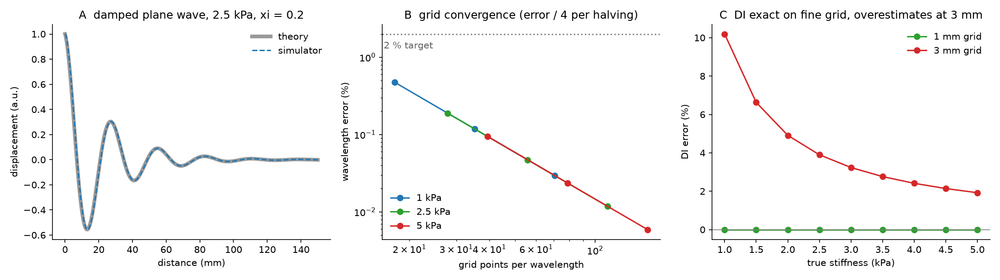
*(A) Damped plane wave, simulator against theory. (B) Wavelength error against grid points per wavelength. (C) Direct-inversion error on the 1 mm and 3 mm grids.*

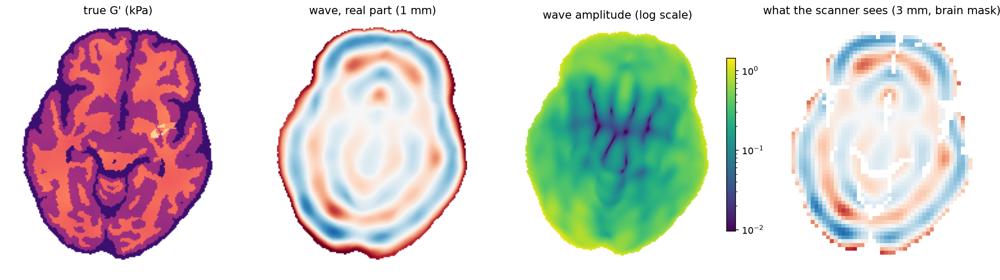
*One brain: true G', simulated wave (1 mm), wave amplitude, and the 3 mm data seen by the scanner.*

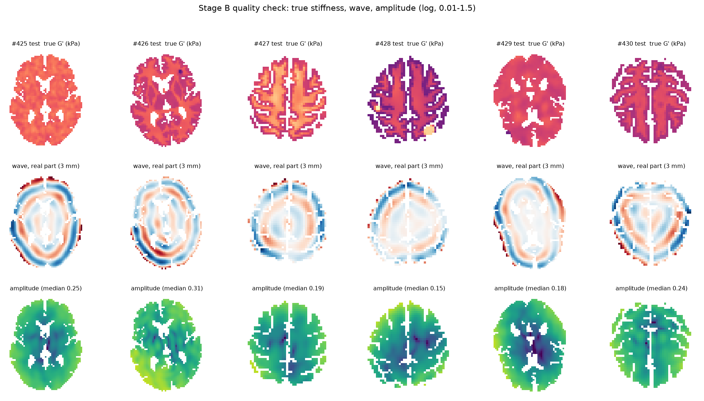
*Test brains #425–430: true G', real part of the 3 mm wave field, and wave amplitude.*

### Network versus direct inversion

All results below are on the 75 test brains at SNR 20 unless stated otherwise.

| Metric | DI | HLI | ILI |
|---|---|---|---|
| Median absolute error | 10.3 % | 8.6 % | 6.8 % |
| Correlation with true G' | 0.50 | 0.77 | 0.84 |
| Inclusion contrast transfer (median) | 22 % | 23 % | 35 % |

DI is undefined within 4 mm of CSF or the brain edge, which covers 28 % of brain voxels. In that band the ILI error is 10.2 %, about double its 5.5 % error more than 13 mm from CSF.

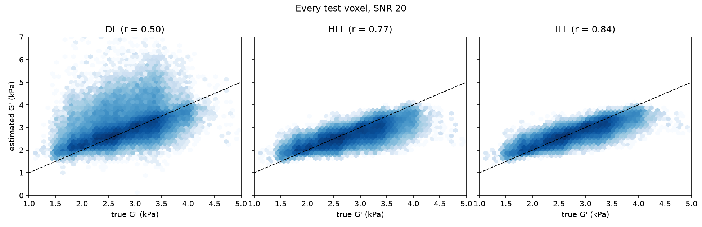
*Estimated against true G' for every test voxel at SNR 20.*

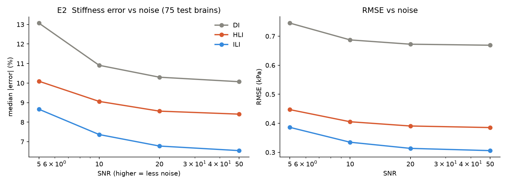
*Median absolute error and RMSE against SNR.*

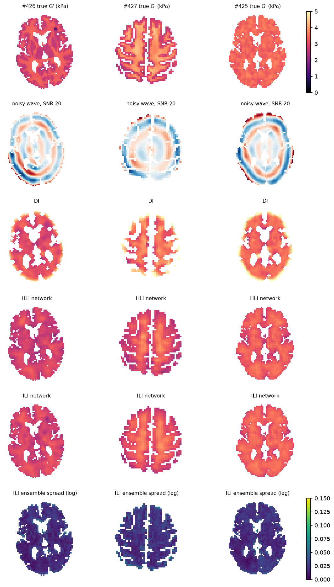
*Three test brains: true G', noisy wave, DI, HLI and ILI estimates, and ILI ensemble spread.*

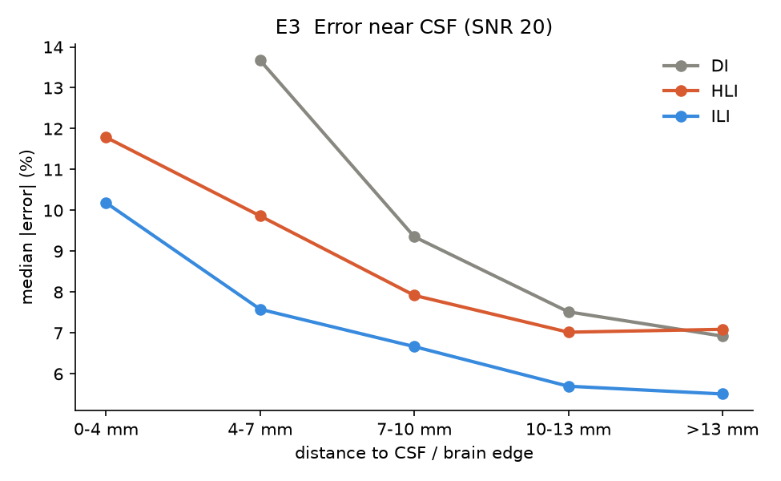
*Median absolute error against distance to CSF or the brain edge (SNR 20). DI is undefined in the 0–4 mm band.*

### Trust map v1

Each voxel gets two warning signals that do not use the true stiffness:

- a weak-form physics residual: the network's stiffness is inserted back into the wave equation and the result is normalised by the noise floor
- the spread of the 5-member ILI ensemble

The task is to detect voxels with more than 20 % error.

| Score (SNR 20) | AUC |
|---|---|
| Physics residual | 0.56 |
| Ensemble spread | 0.59 |
| Combined | 0.60 |
| Near-CSF rule (baseline) | 0.61 |

Trust map v1 did not beat the near-CSF baseline. We identified five causes:

- Wave nulls make the residual uninformative where amplitude is low.
- The residual scales with wave amplitude rather than with the stiffness error.
- Noise adds spurious curvature, which biases the residual.
- The 3 mm grid bias is mistaken for a stiffness error.
- Ensemble members share the same systematic mistakes, so their spread misses them.

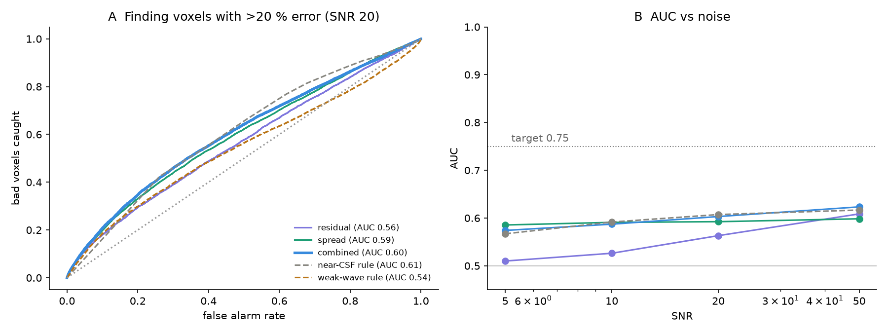
*(A) ROC curves for detecting voxels with more than 20 % error at SNR 20. (B) AUC against SNR.*

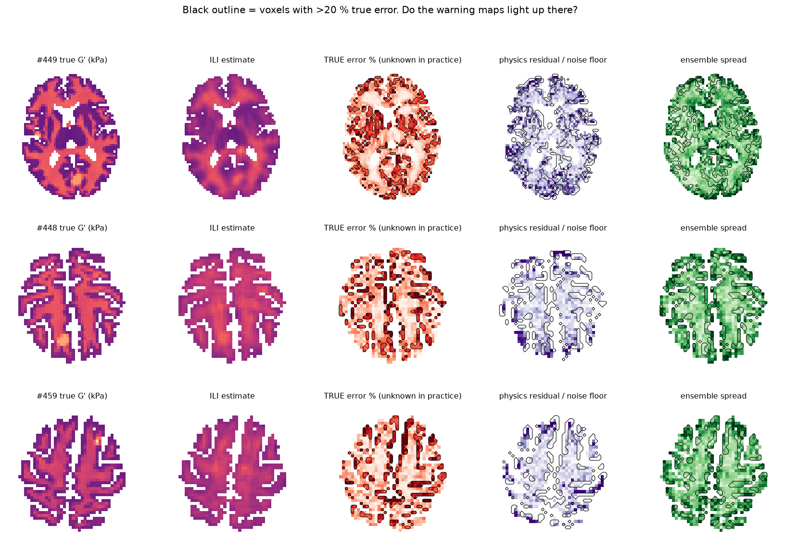
*True G', ILI estimate, true error (voxels over 20 % outlined), physics residual and ensemble spread for three test brains.*

### Trust map v2.1

Version 2.1 replaces the residual with a physics correction: the relative stiffness change needed to balance the wave equation locally. A method-of-moments correction removes the noise bias, and the 3 mm grid bias is corrected with the C1 table. These physics features are combined with anatomical features and the network output, and an error-predicting network is trained as an alternative.

All design choices were made on the validation brains. The final model was fitted on validation brains and scored once on the test brains.

**Sanity check.** Applied to the true stiffness, the physics correction should be close to zero. At SNR 20 it was −23 % before the noise correction and −2.0 % after.

| Score (SNR 20, test) | Voxel AUC | Region AUC (12 mm tiles) |
|---|---|---|
| Near-CSF rule | 0.61 | 0.74 |
| Physics alone | 0.57 | – |
| Anatomy only | 0.62 | 0.75 |
| Anatomy + network | 0.68 | 0.76 |
| Anatomy + network + physics | 0.70 | 0.78 |
| Error-predicting network | 0.70 | – |

Voxel AUC is for voxels with more than 20 % error. Region AUC is for 12 mm tiles whose mean is off by more than 10 %.

| Voxels kept (most trusted first) | 100 % | 75 % | 50 % | 25 % | 10 % |
|---|---|---|---|---|---|
| Median absolute error | 7.6 % | 6.8 % | 6.2 % | 5.6 % | 4.9 % |
| Voxels more than 20 % wrong | 10.8 % | 7.4 % | 5.3 % | 3.3 % | 1.7 % |

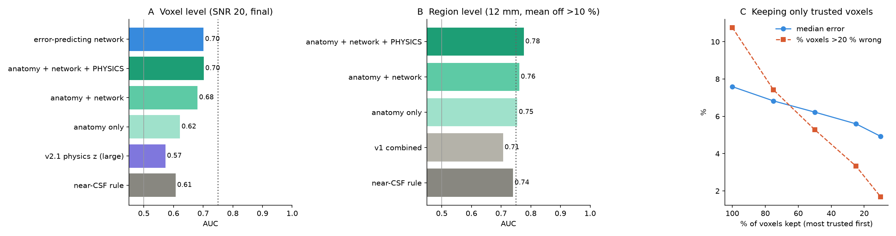
*(A) Voxel-level AUC. (B) Region-level AUC. (C) Error when only the most-trusted voxels are kept. Test brains, SNR 20.*

### Weak-form SINDy per voxel (60 Hz)

For each voxel, two weak-form models are fitted to the surrounding wave field:

- **M0:** uniform stiffness, `G* ∇²u + ρω²u = 0`
- **M1:** linearly varying stiffness, `∇·(G* ∇u) + ρω²u = 0` with `G* = G0 + gx·x + gy·y`

Derivatives are moved onto smooth test functions by summation by parts, so the noisy data is only multiplied and summed. M1 is kept only if the gradient is both large (more than 10 % over 6 mm) and significant. If neither model explains at least 90 % of the noise-corrected data, the voxel is marked "no model fits".

| Data | Clean | SNR 50 | SNR 20 | SNR 10 |
|---|---|---|---|---|
| H1: AUC for detecting truly varying stiffness | 0.88 | 0.79 | 0.64 | 0.52 |
| Physics-only stiffness, median absolute error | 6.0 % | 6.6 % | 7.8 % | 11.4 % |

At SNR 20, the physics verdict separates network errors (H4):

| Physics verdict | Voxels | Network voxels more than 20 % wrong |
|---|---|---|
| M0 fits (uniform) | 70.2 % | 5.4 % |
| M1 fits (varying) | 28.6 % | 9.0 % |
| No model fits | 1.2 % | 16.1 % |
| All voxels | 100 % | 6.5 % |

Where no model fits, the network is badly wrong three times as often as where the uniform model fits.

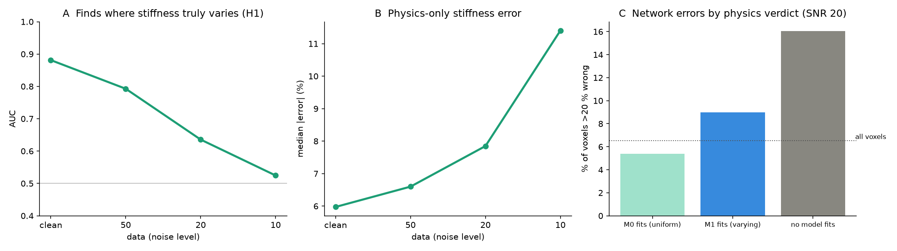
*(A) AUC for detecting truly varying stiffness. (B) Physics-only stiffness error. (C) Share of network voxels more than 20 % wrong, by physics verdict (SNR 20).*

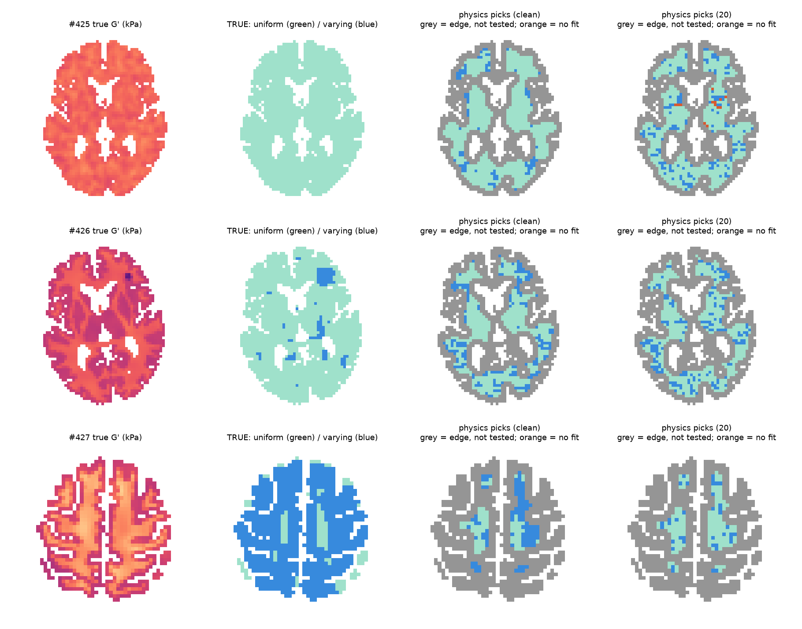
*True G', true uniform/varying label, and the model chosen by the physics on clean data and at SNR 20. Grey voxels are too close to CSF or the brain edge for the test function to fit.*

### SINDy with a 12-term library

Instead of comparing two fixed models, the method is given 12 candidate terms and must choose which ones belong in the equation. The procedure is:

- **Weak-form regression** on 14 uniform regions from the test brains.
- **Sequentially thresholded least squares** (STLSQ) to drop small or non-significant terms.
- **Model selection:** the sparsest model whose R² is within 0.01 of the best.
- **Noise correction:** a method-of-moments refit of the kept terms.
- **Ensemble-SINDy:** 100 bootstrap resamples give each term's inclusion probability.

The correct answer is the 2D Helmholtz equation, which keeps only `∂²u/∂x²` and `∂²u/∂y²` with equal coefficients.

| Term | Physical meaning if selected |
|---|---|
| `∂u/∂x`, `∂u/∂y` | First-order (advection-like) transport. Not present in a time-harmonic elastic wave. |
| `∂²u/∂x²`, `∂²u/∂y²` | The shear-wave operator. The coefficients give the stiffness, and equal coefficients mean isotropy. |
| `∂²u/∂x∂y` | Mixed derivative: anisotropy with axes rotated relative to the grid. |
| `x·u`, `y·u` | Position-dependent inertia (density) or reaction term. |
| `x·∇²u`, `y·∇²u` | Stiffness that varies linearly in space (heterogeneous tissue in the region). |
| `∂³u/∂x³`, `∂³u/∂y³` | Odd third-order derivatives: dispersion or discretisation artefacts. |
| `∇⁴u` | Fourth-order term: strain-gradient (bending-like) elasticity, or noise fitted by high-order smoothing. |

For one region in test brain #425 (clean data), the selected equation was

```
ρω²u + 3.52 kPa · ∂²u/∂x² + 3.47 kPa · ∂²u/∂y² = 0
```

After the 3 mm grid-bias correction, the stiffness read from this equation is G' = 3.41 kPa (bootstrap 95 % interval 3.40–4.01 kPa), against a true value of 3.43 kPa. At SNR 20 the same region kept a small spurious `∇⁴u` term and gave 3.77 kPa.

| Data | Clean | SNR 50 | SNR 20 | SNR 10 |
|---|---|---|---|---|
| Regions with exactly the wave equation | 79 % | 93 % | 93 % | 14 % |
| Regions containing both second-derivative terms | 100 % | 100 % | 100 % | 100 % |
| Median stiffness error from the formula | 1.3 % | 0.9 % | 1.2 % | 8.8 % |

Ensemble-SINDy inclusion probabilities at SNR 20 are 1.00 for `∂²u/∂x²` and 0.96 for `∂²u/∂y²`. All other terms are at 0.10 or below; the highest is `∇⁴u` at 0.10. At SNR 10, `∇⁴u` rises to 0.88, which is where the method breaks down.

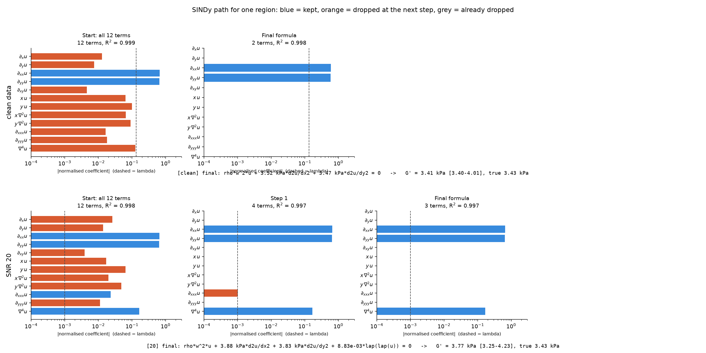
*Term selection for one region in brain #425: all 12 terms at the start and the final formula, on clean data (top) and at SNR 20 (bottom).*

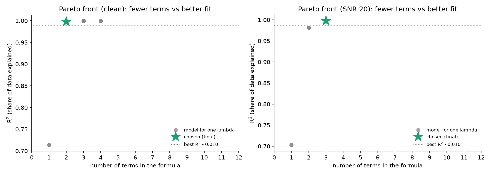
*Pareto front of fit (R²) against number of terms. The star marks the selected model.*

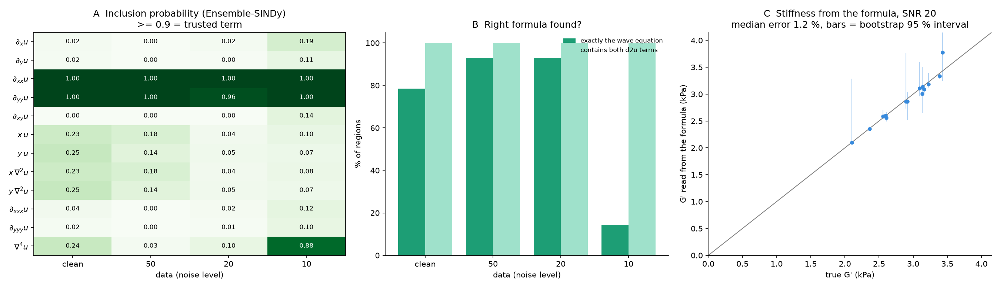
*(A) Ensemble-SINDy inclusion probabilities. (B) Share of regions where the exact wave equation was recovered. (C) Stiffness from the formula against the true value at SNR 20, with bootstrap 95 % intervals.*

## Limitations

- **Simplified physics and data.** The study is 2D and synthetic, with anti-plane shear waves at a single frequency (60 Hz). CSF is modelled as a soft solid rather than a fluid. Real MRE data is 3D, multi-component and affected by artefacts not simulated here.
- **SINDy breaks down near SNR 10.** The exact wave equation is recovered in only 14 % of regions, and the stiffness error rises to 8.8 %.
- **Edge voxels cannot be tested.** Weak-form test functions need a fully interior neighbourhood, so voxels next to CSF and the brain edge get no physics check. These are the voxels where inversion errors are largest.
- **E7 regions use ground truth.** The uniform regions in E7 were selected with the true stiffness, as a way to validate the method. A deployable version must find uniform regions from the data alone.
- **Physics flags errors but does not correct them.** At the region level, the mean physics correction is barely correlated with the actual error (r = 0.03 at SNR 20), so it cannot yet be used to correct the network.

## Next steps

- Physics-informed training: add the weak-form wave-equation residual to the network loss.
- A wider receptive field, for example a U-Net, instead of 7 × 7 patches.
- SINDy for heterogeneous tissue and for the CSF boundary, including interface conditions.
- Fluid (rather than soft-solid) CSF.
- Multi-frequency data, which also makes extra terms such as `c·u` identifiable.
- Extension to 3D and to real MRE data.

## Getting started

The scripts were developed with Python 3 on Windows.

```
python -m venv .venv
.venv\Scripts\activate
pip install -r requirements.txt
```

Stage A expects SynthSeg segmentations of the healthy ageing templates in `example/CN_templates/` (not included). Run the scripts in this order. Outputs are written to `mre_project/`.

```
python stage_a_make_brains.py
python b1_checks.py
python stage_b2_simulate.py
python stage_c1_make_patches.py
python stage_c2_train.py
python stage_d1_evaluate.py
python stage_e1_trust_map.py
python stage_f1_predict_val.py
python stage_f2_trust_v2.py
python stage_f3_trust_v21.py dev
python stage_f3_trust_v21.py final
python stage_e6_weak_windy_60hz.py
python stage_e7_sindy_library.py
```

Simulation (`stage_b2_simulate.py`) and training (`stage_c2_train.py`) are the slow steps. Both skip work that is already finished, so they can be stopped and restarted. Several scripts accept a number of brains as an argument for a quick check, for example `python stage_e7_sindy_library.py 10`.

## References

1. Murphy MC, Manduca A, Trzasko JD, Glaser KJ, Huston J, Ehman RL. Artificial neural networks for stiffness estimation in magnetic resonance elastography. *Magn Reson Med*. 2018;80:351–360. [doi:10.1002/mrm.27019](https://doi.org/10.1002/mrm.27019)
2. Scott JM, Arani A, Manduca A, et al. Artificial neural networks for magnetic resonance elastography stiffness estimation in inhomogeneous materials. *Med Image Anal*. 2020;63:101710. [doi:10.1016/j.media.2020.101710](https://doi.org/10.1016/j.media.2020.101710)
3. Scott JM, Pavuluri K, Trzasko JD, et al. Impact of material homogeneity assumption on cortical stiffness estimates by MR elastography. *Magn Reson Med*. 2022;88:916–929. [doi:10.1002/mrm.29226](https://doi.org/10.1002/mrm.29226)
4. Hiscox LV, Johnson CL, Barnhill E, et al. Magnetic resonance elastography (MRE) of the human brain: technique, findings and clinical applications. *Phys Med Biol*. 2016;61:R401–R437. [doi:10.1088/0031-9155/61/24/R401](https://doi.org/10.1088/0031-9155/61/24/R401)
5. Hiscox LV, McGarry MDJ, Schwarb H, et al. Standard-space atlas of the viscoelastic properties of the human brain. *Hum Brain Mapp*. 2020;41:5282–5300. [doi:10.1002/hbm.25192](https://doi.org/10.1002/hbm.25192)
6. Billot B, Greve DN, Puonti O, et al. SynthSeg: segmentation of brain MRI scans of any contrast and resolution without retraining. *Med Image Anal*. 2023;86:102789. [doi:10.1016/j.media.2023.102789](https://doi.org/10.1016/j.media.2023.102789)
7. Brunton SL, Proctor JL, Kutz JN. Discovering governing equations from data by sparse identification of nonlinear dynamical systems. *Proc Natl Acad Sci USA*. 2016;113:3932–3937. [doi:10.1073/pnas.1517384113](https://doi.org/10.1073/pnas.1517384113)
8. Rudy SH, Brunton SL, Proctor JL, Kutz JN. Data-driven discovery of partial differential equations. *Sci Adv*. 2017;3:e1602614. [doi:10.1126/sciadv.1602614](https://doi.org/10.1126/sciadv.1602614)
9. Messenger DA, Bortz DM. Weak SINDy for partial differential equations. *J Comput Phys*. 2021;443:110525. [doi:10.1016/j.jcp.2021.110525](https://doi.org/10.1016/j.jcp.2021.110525)
10. Mangan NM, Kutz JN, Brunton SL, Proctor JL. Model selection for dynamical systems via sparse regression and information criteria. *Proc R Soc A*. 2017;473:20170009. [doi:10.1098/rspa.2017.0009](https://doi.org/10.1098/rspa.2017.0009)
11. Fasel U, Kutz JN, Brunton BW, Brunton SL. Ensemble-SINDy: robust sparse model discovery in the low-data, high-noise limit, with active learning and control. *Proc R Soc A*. 2022;478:20210904. [doi:10.1098/rspa.2021.0904](https://doi.org/10.1098/rspa.2021.0904)
12. McGarry M, Van Houten E, Guertler C, et al. A heterogenous, time harmonic, nearly incompressible transverse isotropic finite element brain simulation platform for MR elastography. *Phys Med Biol*. 2021;66:055029. [doi:10.1088/1361-6560/ab9a84](https://doi.org/10.1088/1361-6560/ab9a84)
